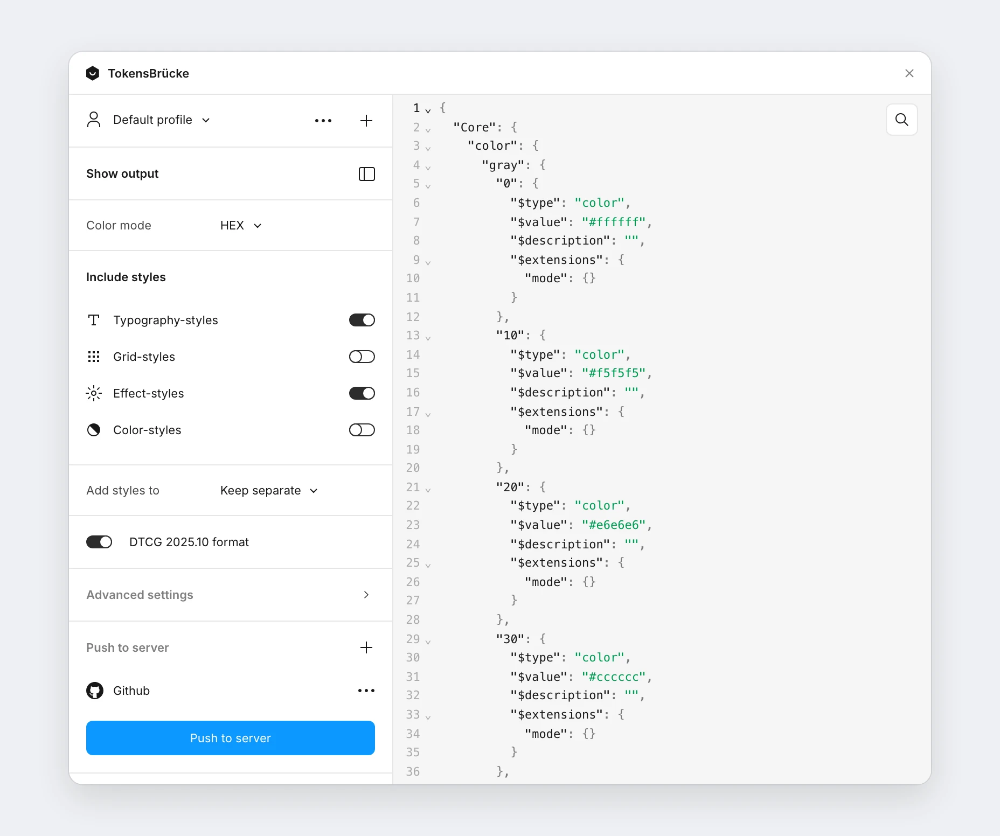

# TokensBruecke — Figma plugin and CLI

<a href="https://www.figma.com/community/plugin/1254538877056388290" target="_blank">
<picture>
  <source media="(prefers-color-scheme: dark)" srcset="./docs/src/assets/screenshots/overview-dark.webp">
  
</picture>
</a>

TokensBruecke exports Figma variables and styles as design tokens JSON compatible with the [DTCG 2025.10 specification](https://www.designtokens.org/tr/2025.10/format/), and imports tokens back into Figma variables. Use it as a Figma plugin, as a CLI in CI and agent workflows, or as a library in your build.

**📖 Documentation: [tokens-bruecke.github.io/figma-plugin](https://tokens-bruecke.github.io/figma-plugin/)**

## Figma plugin

1. Install the plugin from the [Figma Community](https://www.figma.com/community/plugin/1254538877056388290).
2. Run it in any Figma file and adjust the [settings](https://tokens-bruecke.github.io/figma-plugin/plugin/settings/).
3. Download the JSON file or [push it to a server](https://tokens-bruecke.github.io/figma-plugin/plugin/push-to-server/): JSONBin, GitHub, a GitHub pull request, GitLab or your own endpoint.

The plugin also runs in [Dev Mode](https://tokens-bruecke.github.io/figma-plugin/plugin/dev-mode/), so developers can export tokens themselves; [share a profile in the file](https://tokens-bruecke.github.io/figma-plugin/plugin/profiles/#shared-profiles) to give them your settings.

A file without variables opens on an empty screen, where you can [import tokens](https://tokens-bruecke.github.io/figma-plugin/getting-started/export-and-import/) or continue to export styles only.

## Use as cli tool

The CLI is published on npm as [tokens-bruecke](https://www.npmjs.com/package/tokens-bruecke). It reads a file from the Figma REST API (Enterprise plan) or from a local snapshot (any plan).

```bash
# From the Figma REST API
npx tokens-bruecke@latest --api-key $FIGMA_TOKEN --file-key $FIGMA_FILE --output out/tokens.json

# From a local snapshot — no token required
npx tokens-bruecke@latest --input snapshot.json --output out/tokens.json

# Write a configuration file with the export settings
npx tokens-bruecke@latest init
```

See the [CLI docs](https://tokens-bruecke.github.io/figma-plugin/cli/overview/) for every [option](https://tokens-bruecke.github.io/figma-plugin/cli/options/), the configuration file and the snapshot format. Agents can start from [llms.txt](llms.txt) and the [agent skill](skills/tokens-bruecke/SKILL.md).

## Use as a library

```ts
import { fetchTokens, convertTokens } from 'tokens-bruecke/api';

const tokens = await fetchTokens({
  fileKey: 'abc123',
  personalAccessToken: myToken,
  options: { colorMode: 'hex' },
});

const fromSnapshot = await convertTokens(snapshot, { splitByCollection: true });
```

See [Use as a library](https://tokens-bruecke.github.io/figma-plugin/library/) for results, warnings and error codes.

## Documentation

| Topic | |
| --- | --- |
| [Export and import](https://tokens-bruecke.github.io/figma-plugin/getting-started/export-and-import/) | What gets exported, and what to know before importing |
| [Settings](https://tokens-bruecke.github.io/figma-plugin/plugin/settings/) and [advanced settings](https://tokens-bruecke.github.io/figma-plugin/plugin/advanced-settings/) | Color modes, styles, DTCG format, splitting files, scopes and more |
| [Push to server](https://tokens-bruecke.github.io/figma-plugin/plugin/push-to-server/) | JSONBin, GitHub, GitHub PR, GitLab and custom servers |
| [Profiles](https://tokens-bruecke.github.io/figma-plugin/plugin/profiles/) | Multiple profiles, and profiles shared in the Figma file |
| [Output and window](https://tokens-bruecke.github.io/figma-plugin/plugin/output/) | Code preview and window height |
| [Dev Mode](https://tokens-bruecke.github.io/figma-plugin/plugin/dev-mode/) | Exporting tokens from Dev Mode and Figma for VS Code |
| [Token structure](https://tokens-bruecke.github.io/figma-plugin/reference/token-structure/) | How collections, groups and modes map to JSON |
| [Aliases](https://tokens-bruecke.github.io/figma-plugin/reference/aliases/) | Aliases, color aliases with opacity, library variables |
| [Styles support](https://tokens-bruecke.github.io/figma-plugin/reference/styles/) | Typography, colors, grids, shadows and blur |
| [Types and scopes](https://tokens-bruecke.github.io/figma-plugin/reference/types/) | Variable types, motion variables and scopes |

The documentation lives in [`docs/`](docs). See [CONTRIBUTING.md](CONTRIBUTING.md) to run it locally and to regenerate the screenshots.

## Privacy and analytics

The plugin counts a few anonymous usage events with [GoatCounter](https://www.goatcounter.com). It never sends your tokens, names, server URLs, access tokens or anything else read from your Figma file. See [Privacy](https://tokens-bruecke.github.io/figma-plugin/privacy/) for the full list.

## Feedback

If you have any questions or suggestions, feel free to [create an issue](https://github.com/tokens-bruecke/figma-plugin/issues).
